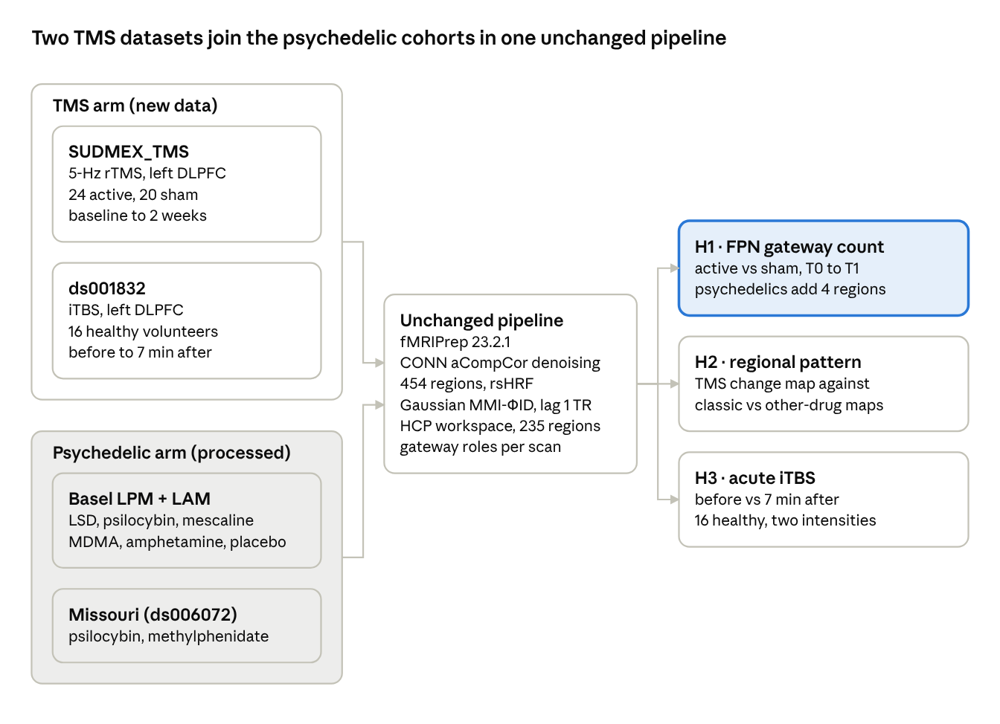
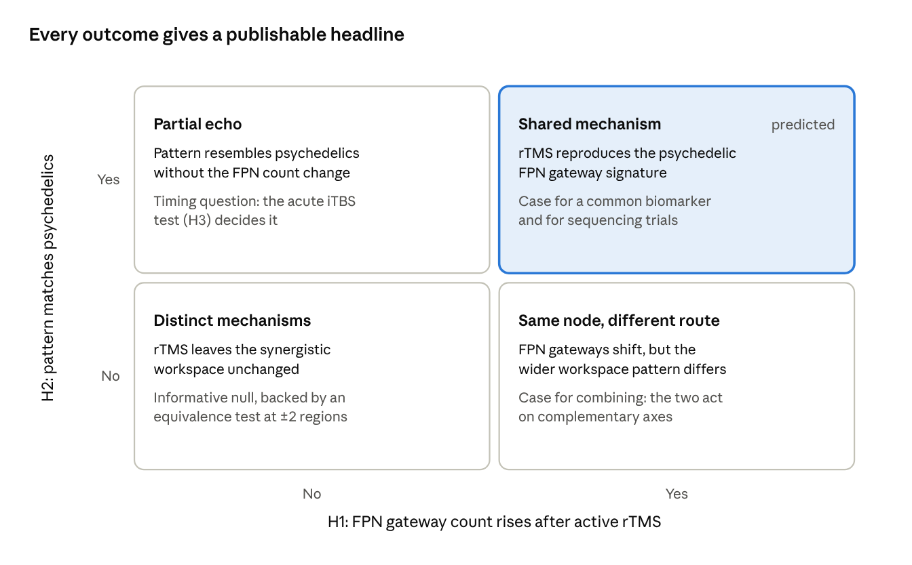
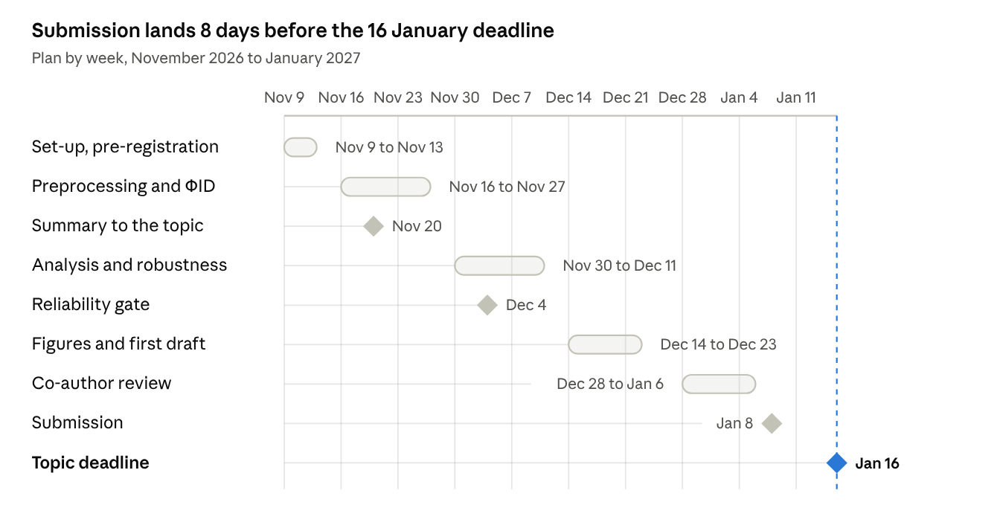

# Project Proposal: TMS and Psychedelics in the Synergistic Workspace

5 November 2026 · Parsa

Exported copy. The live, editable version is the master: https://claude.ai/artifact/GuSdNTeR2s4ZRWKfFYmGqZ

## Summary

**Question.** Does a course of prefrontal rTMS shift the brain's synergistic workspace the way classic psychedelics do? In our Integrated Information Decomposition (ΦID) pipeline, LSD, psilocybin and mescaline each add about 4 frontoparietal (FPN) gateway regions (effect sizes 0.63 to 0.89); MDMA and amphetamine do not. The standard rTMS target, the left DLPFC, sits in the FPN.

**Plan.** Run the unchanged pipeline on [SUDMEX_TMS](https://openneuro.org/datasets/ds003037), an open, double-blind, sham-controlled trial of 5-Hz left-DLPFC rTMS (24 active, 20 sham). A healthy single-session iTBS dataset ([ds001832](https://openneuro.org/datasets/ds001832), n = 16) tests the acute effect. The psychedelic arms are already processed.

**Payoff.** A shared signature makes FPN gateway synergy a candidate common biomarker for combining psychedelics and TMS; a distinct one shows they act on separate axes. Either result fits the Research Topic, and its Brief Research Report format welcomes negative results. Cost: about 20 GB of open data, 3 days of compute and 4 person-weeks, with submission by 8 January 2027.

## Why this call

The Frontiers in Psychiatry [Research Topic](https://www.frontiersin.org/research-topics/80360/psychedelic-medicine-and-neuromodulation-from-bench-to-bedside-advancing-real-world-implementation-of-next-generation-psychiatric-treatments) closes for manuscripts on 16 January 2027 and asks directly how psychedelics and neuromodulation interact at the systems level.

| Item | Detail |
| --- | --- |
| Article type | Brief Research Report: up to 4,000 words and 4 figures or tables; negative results explicitly encouraged ([article types](https://www.frontiersin.org/journals/psychiatry/for-authors/article-types)) |
| Fee | B-type, CHF 2,500; Original Research would be A-type, CHF 3,150 ([publishing fees](https://www.frontiersin.org/journals/psychiatry/for-authors/publishing-fees)) |
| Section | Neurostimulation (the topic also runs in Psychopharmacology) |
| Topic goals met | Goal 1, interaction mechanisms at the systems level; goal 3, biomarkers; listed themes "neuroimaging correlates of single vs. combined interventions" and substance use disorders |
| Editors | Kenneth Shinozuka (Oxford) co-wrote a synergy-framed meta-analysis of psychedelics with ΦID co-developer Pedro Mediano ([Shinozuka et al., 2024](https://doi.org/10.1038/s41398-024-03187-1)); Owen Muir is a Clinical TMS Society fellow |

The topic page also accepts a manuscript summary before the full paper; sending one in November gets an early editorial read.

## Rationale and hypotheses

Our own data fix the primary outcome in advance: the FPN gateway count, the only drug-specific workspace effect that survived every check in our tier-1 robustness analysis (13 October 2026).

| Signature (Basel LPM + LAM) | Classic psychedelics | MDMA / amphetamine | Robustness | Use here |
| --- | --- | --- | --- | --- |
| FPN gateway count (baseline 14 to 16 regions) | +4.0 to +4.6 regions; effect size 0.63 to 0.89 | +1.6 / −0.3, not significant | Holds with NuMIT normalisation, 5 workspaces, no deconvolution, GSR, tSNR | Primary outcome |
| Mean redundancy PC | Rises | Rises | Holds everywhere; not drug-specific | Generic perturbation check |
| Mean synergy PC | Rose in published pipeline | — | Lost under NuMIT and TDMI adjustment | Not used |
| DAN and DMN gateway counts | Rose in some conditions | — | Depends on workspace definition | Exploratory |

A gateway is a workspace region whose synergistic links spread across networks more than its redundant links do. In SUDMEX, 5-Hz rTMS strengthened coupling between the left DLPFC and ventromedial PFC, an FPN to default-mode link ([Garza-Villarreal et al., 2021](https://pubmed.ncbi.nlm.nih.gov/33508499/)). Cross-network coupling at an FPN node is what the gateway metric reads, so a shift is plausible.

The only stimulation study using ΦID we found is in macaques: focal ultrasound changed synergy and redundancy topology at the stimulated site ([Gatica et al., 2024](https://doi.org/10.1162/netn_a_00388)). We found no human TMS study using it.

Hypotheses, pre-registered on OSF, with group labels masked until the pipeline is frozen:

1. **H1, primary.** Active versus sham rTMS raises the FPN gateway count from baseline (T0) to 2 weeks (T1): a group × time interaction in the psychedelic direction.
2. **H2, pattern.** Across the 235 workspace regions, the change in gateway propensity after active rTMS correlates with the classic-psychedelic map more than with the MDMA and amphetamine map.
3. **H3, acute.** One iTBS session raises the FPN gateway count 7 minutes later in healthy volunteers (ds001832), pooled over 90% and 120% of motor threshold.
4. **Exploratory.** Durability at 3, 6 and 12 months; the sham arm's switch to open-label rTMS (T1 to T14, n = 14); links to change in craving and impulsivity.

## Data

SUDMEX_TMS is the primary dataset: the only open, sham-controlled DLPFC-rTMS trial with resting fMRI we found on OpenNeuro. Usable counts below were checked against the OpenNeuro files on 5 November 2026.

SUDMEX_TMS, ds001832 and ds008174 are resting-state fMRI: the TMS is given outside the scanner, and rest scans before and after measure its effect. The psychedelic arms have the same design, rest scans under drug versus placebo or baseline, so the pipeline runs unchanged. Only the Stanford dataset delivers pulses during scanning, so its pulse-evoked responses would need removing first; that makes it the follow-up paper.

| Dataset | Design | Usable N | Stimulation | Rest fMRI | Size, licence | Role |
| --- | --- | --- | --- | --- | --- | --- |
| [SUDMEX_TMS (ds003037)](https://openneuro.org/datasets/ds003037) | Double-blind RCT, parallel arms; baseline (T0) and 2 weeks (T1), then open-label follow-up | 24 active + 20 sham with T0 and T1; 14 sham with open-label T14; 15, 9 and 2 active at 3, 6 and 12 months | 5-Hz rTMS, left DLPFC, 2 sessions a day for 2 weeks; cocaine use disorder | 10 min, TR 2.0 s, 300 volumes, Philips 3T | 16 GB, CC0 | Primary |
| [Resting State – TMS (ds001832)](https://openneuro.org/datasets/ds001832) | Within-subject, 2 visits (90% and 120% of motor threshold), scans before and 7 min after | 16 healthy | iTBS, 600 pulses, left DLPFC; no sham | 10 min, TR 2.0 s, 300 volumes, 3T | 3.4 GB, CC0 | Acute replication |
| [cTBS dystonia trial (ds008174)](https://openneuro.org/datasets/ds008174) | Sham-controlled crossover; scans before and 90 min after | 13 patients | cTBS, bilateral S1, outside the FPN | Siemens Skyra 3T | 32 GB, CC0 | Optional off-target control |
| [spTMS-fMRI (Glick et al., 2025)](https://doi.org/10.1038/s41597-025-05377-y) | Concurrent single-pulse TMS-fMRI at 11 cortical sites | 152 in 4 clinical groups | Single pulses | Rest and TMS runs | Access route not yet confirmed | Follow-up paper |

The psychedelic arms need no new compute. Basel LPM (LSD, psilocybin, mescaline, placebo; n = 30 to 31) and Basel LAM (LSD, MDMA, amphetamine, placebo; n = 26) supply the FPN result. Missouri psilocybin with a methylphenidate control ([ds006072](https://openneuro.org/datasets/ds006072), n = 7) adds an open arm whose FPN count we have not yet extracted.

Basel data are not public, so the paper shares their group-level maps only. SUDMEX clinical scores, including craving and impulsivity, are on Zenodo per the dataset README.

## Study design

Both TMS datasets pass through the exact pipeline that produced the psychedelic results, so the comparison is like for like; only the inputs are new.

## Analysis plan

Every stage reuses the production pipeline unchanged; the new code is one config per TMS dataset and the group × time model.

1. **Preprocessing.** fMRIPrep 23.2.1 without distortion correction, using the baseline T1w for all sessions (as for Monash). CONN aCompCor denoising: 5 WM + 5 CSF components, 6 motion parameters + derivatives, 0.008 to 0.09 Hz, no GSR. First 5 volumes dropped; Luppi motion QC.
2. **Regions and ΦID.** Schaefer-400 + Tian-54 atlas (454 regions), rsHRF deconvolution, then Gaussian MMI-ΦID per scan: persistent synergy (sts) and redundancy (rtr) at a lag of 1 TR = 2.0 s, close to Basel's 1.8 s.
3. **Workspace roles.** Fixed HCP workspace (235 regions). Per scan, a region is a gateway when its synergy participation-coefficient rank exceeds its redundancy rank, over 8 modules.
4. **H1.** Linear mixed model: FPN gateway count ~ group × time + mean framewise displacement + age + sex + (1 | subject), two-sided α = .05. With 24 versus 20, 80% power needs d = 0.87; a psychedelic-sized effect (0.84) has 77% power.
5. **H2.** Spatial correlation of regional change maps against spin-based nulls (cortex) and label permutation (subcortex), interpreted only if each map's split-half reliability is above zero.
6. **H3.** Paired model, post minus pre, with intensity as a factor; 80% power for d = 0.75 at n = 16.
7. **Robustness, mirroring tier 1.** NuMIT-normalised atoms, HCP workspace at 2.16 s lag, no deconvolution, GSR, and a 2-TR lag. A null H1 is reported with Bayes factors and an equivalence test at ±2 regions, half the psychedelic effect.
8. **Reliability by-product.** The sham arm's T0 to T1 intraclass correlation gives a 2-week test–retest estimate for gateway counts.

## Expected outcomes

Only the bottom-left quadrant is a null, and the equivalence test turns it into a bounded negative result, which the Brief Research Report format explicitly accepts.

## Timeline and effort

Effort is about 4 person-weeks: 1 for set-up and processing, 1 for analysis, 2 for figures and writing. Compute is about 3 days on the local workstation for about 170 scans. fMRIPrep takes roughly 14 hours on 4 workers and CONN about 8 minutes a scan; ΦID and NuMIT add a few hours. Derivatives need about 250 GB of disk.

## Risks

The one risk that can stop the project is MATLAB access for CONN denoising; every other risk changes the story, not whether there is a paper.

| Risk | Likelihood | Fallback |
| --- | --- | --- |
| MATLAB licence offline, blocking CONN denoising (it was offline in October 2026) | Medium | Confirm access in week 1. rsHRF and ΦID already have validated Python ports; CONN has none |
| rTMS effect too small to detect (d below 0.87) | Medium to high | Equivalence test and Bayes factors make a null informative; the article type welcomes negative results |
| Synergy maps unreliable at this TR, as in London LSD and Monash | Medium | H1 rests on the count, which survived; split-half gate before any map claim |
| Patients with cocaine use disorder versus healthy psychedelic volunteers | Certain | Healthy iTBS replication; within-subject contrasts only; framed as a mechanism test |
| Lasting post-course effect versus acute drug state | Certain | ds001832 scans 7 min after stimulation, matching the acute drug design |
| Reviewers question NuMIT-ΦID, our own extension of NuMIT | Medium | Primary analysis uses the published pipeline; NuMIT appears only as sensitivity |
| Holidays push past the deadline | Medium | Target 8 January, 8 days early; manuscript summary sent in November |

## Decisions needed

Seven calls for the team before processing starts in the week of 9 November.

- [ ] Authorship and corresponding author; whether to invite the SUDMEX team (Garza-Villarreal lab) as co-authors
- [ ] Article type: Brief Research Report (recommended) or Original Research (CHF 650 more, room for the durability analyses)
- [ ] MATLAB and CONN licence access confirmed
- [ ] Include the optional off-target control (ds008174, cTBS to S1)?
- [ ] Local ethics office confirms no new approval is needed for secondary analysis of de-identified CC0 data
- [ ] Fee: check for an institutional Frontiers agreement
- [ ] Send a manuscript summary to the topic in November?

## Sources

- [Research Topic: Psychedelic Medicine and Neuromodulation](https://www.frontiersin.org/research-topics/80360/psychedelic-medicine-and-neuromodulation-from-bench-to-bedside-advancing-real-world-implementation-of-next-generation-psychiatric-treatments): call text, deadline, editors
- [Frontiers in Psychiatry: article types](https://www.frontiersin.org/journals/psychiatry/for-authors/article-types) and [publishing fees](https://www.frontiersin.org/journals/psychiatry/for-authors/publishing-fees)
- [OpenNeuro ds003037, SUDMEX_TMS](https://openneuro.org/datasets/ds003037): README, participants file, scan headers
- [OpenNeuro ds001832, Resting State – TMS](https://openneuro.org/datasets/ds001832): README and session key
- [OpenNeuro ds008174, cTBS in cervical dystonia](https://openneuro.org/datasets/ds008174): README
- [Garza-Villarreal et al., 2021, Biological Psychiatry: CNNI](https://pubmed.ncbi.nlm.nih.gov/33508499/): SUDMEX trial results
- [Alkhasli et al., 2019, Frontiers in Human Neuroscience](https://doi.org/10.3389/fnhum.2019.00190): iTBS protocol
- [Glick et al., 2025, Scientific Data](https://doi.org/10.1038/s41597-025-05377-y): spTMS-fMRI dataset
- [Gatica et al., 2024, Network Neuroscience](https://doi.org/10.1162/netn_a_00388): ΦID after ultrasound stimulation in macaques
- [Shinozuka et al., 2024, Translational Psychiatry](https://doi.org/10.1038/s41398-024-03187-1): synergy-framed psychedelic meta-analysis
- [Luppi et al., 2024, eLife](https://doi.org/10.7554/eLife.88173): synergistic workspace method
- Internal: tier-1 robustness report and Supplementary Table 2, 13 October 2026 (all Basel effect sizes)
