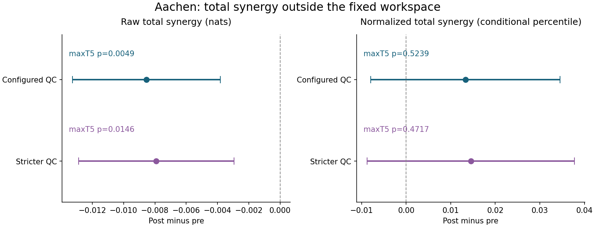

# TMS reanalysis with enforced motion QC

## Current analysis specification

This rerun enforces the existing configuration's scan exclusions before
participant-level inference. Motion is handled by scan QC and the existing
denoising pipeline. There is **no additional continuous FD covariate in the
current group models**. Aachen uses the mean of the two matched within-visit
changes. SUDMEX compares the randomized active and sham groups at two weeks,
adjusting for the baseline outcome. Unadjusted group contrasts are also retained.
The earlier additional-FD-covariate fits are archived, not the selected models.

“Registered” in output directory names means the existing configured thresholds;
it does **not** mean this exploratory analysis was preregistered.

| QC rule | Existing configuration | Stricter sensitivity |
| --- | --- | --- |
| Mean framewise displacement | ≤0.5 mm | ≤0.30 mm |
| Peak framewise displacement | ≤3.0 mm | ≤3.0 mm |
| Fraction of retained frames with FD >0.5 mm | Not a configured exclusion | ≤20% |
| Translation / rotation | ≤3 mm / ≤3.15° under the existing reference-frame rule | Same |
| Retained record length | ≥100 volumes | Same |

Five initial volumes had been removed; existing contiguous truncations were
preserved. The audit used the exact volumes entering CONN, parcellation and
deconvolution, not the full untrimmed confound record. It verified all 193 windows
against preparation logs, archived manifests, confounds, signal metadata and
HRF records. No new frame deletion, concatenation or salvage was introduced.

The displacement rules had been enforced. The configured FD and minimum-length
settings had not been applied by the previous QC implementation. All newly
identified failures under the configured rules exceeded **peak FD 3 mm**;
none failed the mean-FD 0.5-mm criterion. This does not invalidate every retained
signal or require repeating all preprocessing: the affected scans are excluded
and all statistical models and corrections are refitted.

## Retained samples

| Analysis | Before FD enforcement | Configured rules | Stricter sensitivity |
| --- | ---: | ---: | ---: |
| Aachen: both intensity visits complete | 15 | 13 | 12 |
| SUDMEX: acute randomized pairs | 40 (22 active/18 sham) | 33 (18 active/15 sham) | 30 (17 active/13 sham) |
| SUDMEX: baseline versus all available post visits | 41 | 36 | 33 |
| Aachen: anatomically eligible target-flow subset | 8 | 6 | 5 |

Aachen requires all four scans, so an excluded follow-up removes that person
from the two-intensity average. SUDMEX requires passing t0 and t1 for the
randomized comparison. The all-post sensitivity instead requires a passing t0
and at least one passing follow-up, rebuilding each person's average from their
remaining visits, including t14 and t4 where available. Later open-label
treatment prevents interpreting that sensitivity as a continuing randomized
comparison.

## Main finding: outside-workspace total synergy in Aachen

The strongest raw finding is a decrease in **total synergy averaged over region
pairs with both regions outside the fixed HCP workspace**. This is the existing
`synergy_total` composite (`str + stx + sty + sts`), not global Φ or the persistent
synergy atom alone. The external HCP mask and endpoint definitions were unchanged.

| Check | Configured rules | Stricter sensitivity |
| --- | ---: | ---: |
| Mean change, nats | −0.008544 | −0.007913 |
| Marginal 95% CI | [−0.013270, −0.003817] | [−0.012880, −0.002947] |
| Exact unadjusted sign-flip p | .002441 | .004883 |
| Exact maxT, five measures within scope | .004883 | .014648 |
| Exact maxT, all 20 information outcomes | .005859 | .022949 |
| Exact maxT, all 40 information/role outcomes | .027344 | .070313 |
| Every single-participant omission retains decrease and maxT5 p<.05 | 13/13 | 12/12 |

The leave-one-out maxT5 range is .001465–.014648 under configured QC and
.004883–.035156 under stricter QC. These dependent omission fits assess
influence; they are not independent replications. The five-,20- and40-test
families are the previously defined overlapping families, not newly selected
collections of favorable endpoints. Holm and exact maxT results are both
provided in the tables; they are different procedures and need not cross .05
together.

There is limited evidence for spatial specificity. The direct outside-minus-
inside total-synergy change passes maxT5 under configured QC (p=.032959), but
not the stricter sensitivity (p=.083008). A significant outside effect alone
does not establish preferential targeting of the outside-workspace regions.

The SUDMEX baseline-adjusted active-minus-sham effect on this same raw measure
is −0.000737 nats, 95% CI [−0.014315,0.012841], p=.91248 under configured QC;
the stricter estimate is −0.000030, p=.99665. Neither supports replication.

## Remaining outcomes

- Aachen global Φ remains unconfirmed: +0.001845 nats, 95% CI
  [−0.001410,0.005100], exact maxT5 p=.62744 under configured QC. The stricter
  maxT5 p=.66455. The earlier positive global Φ headline remains superseded.
- No four-outcome GWT expectation family establishes the proposed shared
  response. Redundancy participation and DAN gateway counts must be interpreted
  within that four-test family, not promoted from a smaller overlapping family.
- No corrected acute SUDMEX active-versus-sham result is established in the
  core endpoint families. Baseline adjustment is retained; additional group-level
  FD adjustment is not used.
- Target-flow primary results remain unsupported. Small Aachen lag/intensity
  sensitivity findings lack consistent wider-family/exact-test support and
  SUDMEX replication; they are not evidence of stimulation-driven causal flow.
- Pooled SUDMEX all-post raw synergy changes survive several corrections. They
  remain longitudinal changes involving later open-label treatment, both
  original arms and unequal follow-up, not randomized intervention effects.
- Method-by-time interactions remain processing diagnostics. They do not
  establish treatment efficacy. No haemodynamic narrative or inference of
  stability from nonsignificance is used.

## Normalization and final release checks

The previous normalization pools included three failing SUDMEX baseline scans
under configured QC; the stricter policy also excludes two further SUDMEX
baselines and one Aachen baseline. The clean-reference rerun retains all passing
baseline records from the original calibration pools, independently of whether
their follow-ups remain eligible. It keeps the original conditional-CDF
definitions, grid, draw count and two random seeds. Frozen-reference results
remain separately labelled numerical sensitivities.

Normalization is a different conditional estimand, not a gold standard for
deciding whether every raw change is real. The largest interpolation error was
about .0011 on the percentile scale, and simulated finite-record mean-percentile
bias reached about .083 under the specified VAR prior. These diagnostics are
reported, rather than treated as proof that real fMRI follows that prior.

**Release status: complete.** Both QC-clean references, all three core
representations and the no-additional-FD group models have been refitted and
verified. In Aachen, normalized outside-workspace total synergy is +0.013301
(95% CI [−0.007969,0.034571], exact maxT5 p=.52393) under configured QC and
+0.014498 (95% CI [−0.008806,0.037802], p=.47168) under stricter QC. Neither
supports a normalized decrease. Fresh normalized GWT4, clinical56 and SUDMEX
acute families have no corrected survivor. No raw or normalized mode/regional
conjunction establishes a shared response.

Some smaller overlapping families retain isolated signals: raw redundancy
participation in Aachen passes its two-PC family, and strict normalized
redundancy participation also passes that family (maxT2 p=.04834). Neither
passes the four-outcome GWT expectation family. Under configured QC, raw storage
falls across the whole brain, outside the workspace and across its boundary
(maxT6 p=.01611/.01099/.01660); a boundary individual-to-joint conversion increase
also passes maxT6 (p=.04443). None passes full42 correction or the stricter QC
sensitivity. These remain visible in the complete result ledger.

Error bars show marginal 95% intervals; printed p-values are family-wise maxT5.
The two panels estimate different quantities and have different units.

## Publication interpretation

The outside-workspace raw synergy reduction is resistant to individual
participant omission and to the two scan-QC policies within the information
families. That makes it a credible **within-Aachen candidate finding**. Aachen
has no sham condition, the normalized quantity does not currently establish the
same reduction, and the randomized SUDMEX comparison does not reproduce it.
There is therefore still no established shared treatment-effect narrative
across these two datasets. Nonsignificant outcomes do not establish stability.

The new ds001927 cohort remains an independent opportunity to test a site-
controlled contrast; its preprocessing does not supply evidence for the current
finding until its QC and outcome analysis are complete.
The user has selected this route; its
[dated frontal-versus-control plan](DS001927_SITE_COMPARISON_PLAN_20261126.md)
and [pilot coverage review](DS001927_COVERAGE_REVIEW_20261126.md) now document
the new direction. Existing-cohort results above have not been changed.

## Reproducibility

- Exact-window QC: `setup/audit_existing_tms_fd.py` and
  `output/existing_tms_fd_audit_20261126/audit_receipt.json`.
- Selected core models: `setup/rerun_core_after_fd_qc.py`, writing
  `output/tms_fd_reanalysis_20261126/core_qc_only/`.
- Processing modes and refitted external templates: the QC-only mode driver,
  writing `output/tms_fd_reanalysis_20261126/modes_qc_only/`.
- Targets and method diagnostics: `setup/publish_tms_qc_only_views.py`, writing
  `targets_qc_only/` and `sensitivities_qc_only/` within the same run directory.
- Fresh calibration: `setup/recalibrate_normalization_after_fd_qc.py`.
- The dashboard provides aggregate CSV exports and original correction columns.

Original full-sample values were reproduced before exclusions. Independent
checks covered exact sign enumeration, HC3 sandwich calculations, pairing,
clinical missingness and input hashes. Production imaging scripts, frozen HCP
results and the psychedelic datasets were not changed or rerun.
