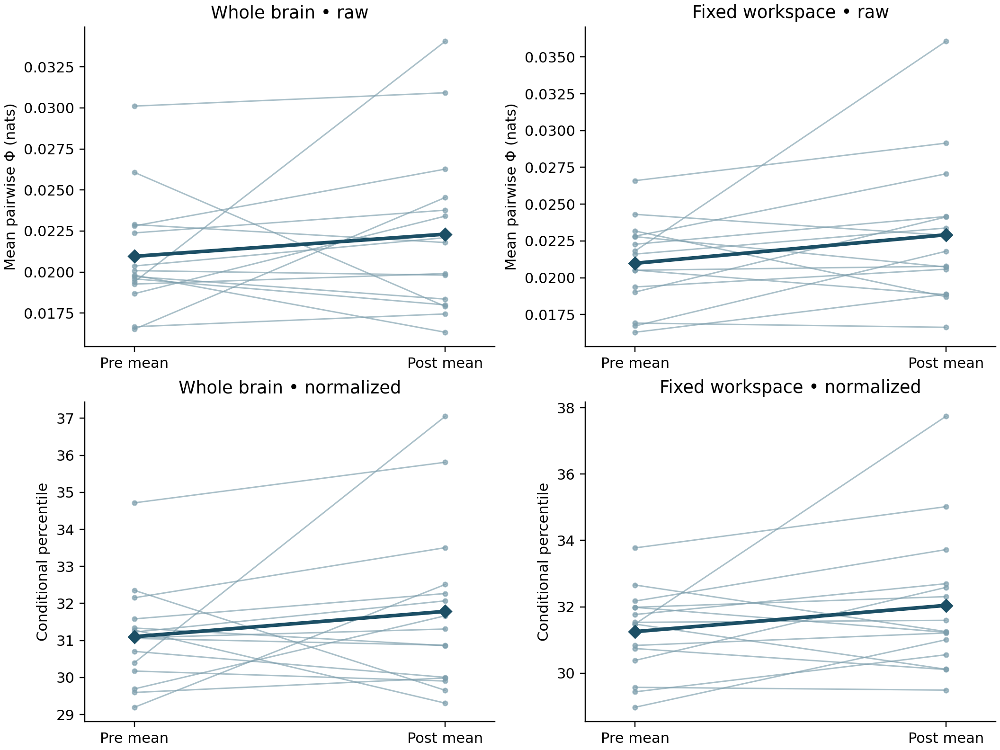
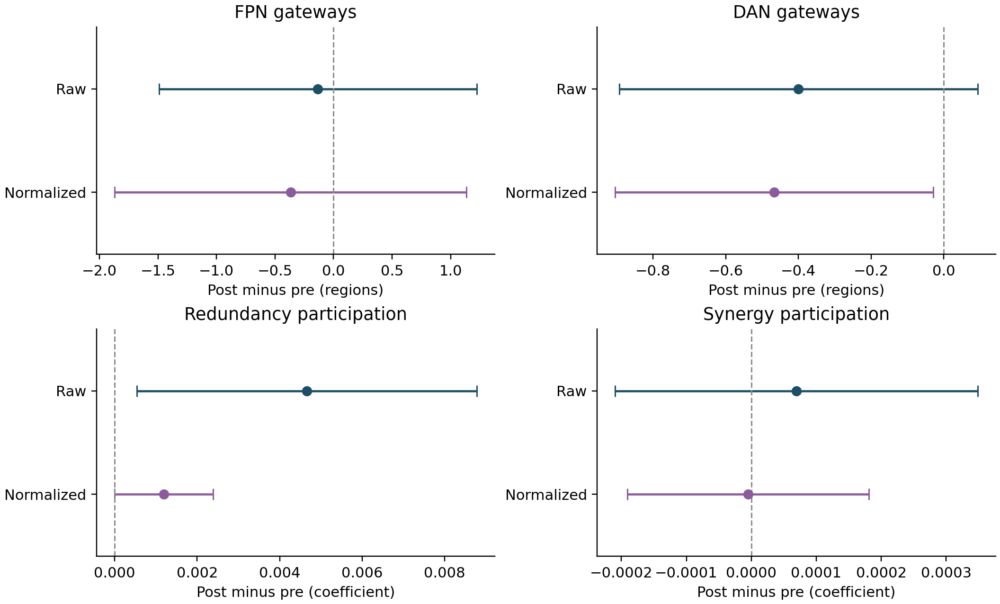

# Information dynamics following prefrontal theta burst stimulation

> Historical draft before full FD exclusion; not ready for submission. The
> current cohort counts and statistics are in
> [the FD-enforced reanalysis report](../../../docs/TMS_FD_REANALYSIS_20261126.md).
> The selected narrative concerns PID effects; the haemodynamic framing below
> is not the current publication plan.

Article type: Brief Research Report

Running title: Information dynamics after prefrontal iTBS

Keywords: intermittent theta burst stimulation; resting state fMRI; integrated information decomposition; prefrontal cortex; neuromodulation; information theory

## Abstract

Prefrontal intermittent theta burst stimulation (iTBS) may influence distributed brain information processing, but a workspace response has not been established. We applied integrated information decomposition to resting-state fMRI from 15 healthy adults scanned before and after two active iTBS intensities. Five information measures and 20 participation and role outcomes were evaluated using 454 haemodynamically deconvolved regional signals and an independent 235-region workspace. Matched visit changes were averaged within participant. Control maps showed broad correspondence with the reference workspace. Whole-brain mean pairwise Φ changed by 0.00135 nats (95% confidence interval -0.00153 to 0.00422; five-measure maximum-t p=0.744). No information measure survived correction within the whole-brain or workspace family, and conditional-null normalization did not establish an effect. Four outcomes motivated by psychedelic workspace findings also failed family-wise correction, including frontoparietal gateway recruitment. Individual Φ changes covaried with fitted haemodynamic-response width in exploratory analyses. These results recover the expected spatial architecture without establishing a consistent acute reorganization after iTBS. Small sample size, absent sham and measurement dependence limit inference; nonsignificance does not demonstrate equivalence.

## Introduction

Prefrontal intermittent theta burst stimulation (iTBS) can affect connectivity beyond the stimulation target (1). Information decomposition offers a complementary description of these distributed dynamics by separating information shared redundantly by regions from information available only through their joint activity (2). Whether prefrontal stimulation measurably changes this information architecture remains unclear.

Previous work identified a synergistic workspace spanning association and subcortical regions (3). Yousefi and colleagues subsequently reported altered cross-network participation and recruitment of frontoparietal and dorsal-attention gateways during psychedelic conditions (4). These findings motivate comparison across interventions, but do not establish that stimulating the dorsolateral prefrontal cortex (DLPFC) should reproduce a psychedelic response or increase mean Φ.

We examined information measures and workspace roles before and after two active iTBS visits in healthy adults. We first assessed whether control data recovered the previously described spatial pattern, then tested within-participant changes using the fixed independent workspace. We retained all planned metric families and examined normalization, motion, spatial scope and target-centred information flow.

## Methods

### Dataset and processing

We reanalysed OpenNeuro ds001832, version 1.0.1 (1). Participants received 600-pulse left-DLPFC iTBS at 90% and 120% of resting motor threshold on separate counterbalanced visits. Ten-minute resting scans preceded stimulation and began approximately seven minutes afterward; stimulation occurred outside the scanner. One of 16 participants was excluded because slice-timing metadata did not match acquisition dimensions. Fifteen participants contributed both complete pre/post pairs, yielding 60 scans. There was no sham condition.

Processing followed the established GWT framework (4): fMRIPrep, CONN denoising, Schaefer-400/Tian-54 parcellation and blind haemodynamic deconvolution with rsHRF (5). Already skull-stripped anatomical inputs were processed without repeat brain extraction. Anatomical alignment, retained signal coverage and all downstream outputs were checked. Gaussian minimum-mutual-information ΦID used a lag of one repetition time, two seconds (3, 2). Supplementary Methods specify processing and remaining regional coverage limitations.

### Information measures and workspace roles

Whole-minus-sum information, Φ, is joint past–future mutual information minus the sum of the two regions' own past–future mutual information (6). It is not synergy alone and may be negative. Redundancy-corrected ΦR adds persistent redundancy. Persistent synergy, persistent redundancy and total source-side synergy complete the five-measure information family.

We averaged each measure over 102,831 unique whole-brain pairs and over the 27,495 pairs wholly within the fixed 235-region HCP workspace used by Yousefi and colleagues (4). Outside-workspace and cross-boundary summaries were retained as spatial sensitivities. These are pairwise averages, not integrated information of the brain considered as a single system. They also differ from Luppi's edgewise network-based inference (3).

Weighted participation coefficients describe how each node's synergistic or redundant connections spread across eight modules. They use all 454 destinations; averages and role classification use the fixed workspace. A node is a gateway when its synergy-participation rank exceeds its redundancy-participation rank, and a broadcaster for the reverse ordering; ties are neither. We retained two mean coefficients, two total role counts and eight network counts for each role. Four literature-motivated expectations were evaluated together: increased frontoparietal (FPN) gateways, dorsal-attention (DAN) gateways, redundancy participation and synergy participation (4). The evidence for synergy participation was less consistent across drug conditions; these comparisons are exploratory extensions to iTBS.

### Statistical analysis and sensitivities

Post-minus-pre differences were calculated within each visit and averaged within participant, retaining 15 independent observations. Time series were not pooled. Two-sided maximum-|t| tests used all 32,768 shared participant sign patterns. The five information measures formed a family at each spatial scope; broader corrections covered ten whole-brain/workspace measures, twenty information-by-scope measures and all forty information/role endpoints. The four literature-motivated outcomes received Holm and maximum-t correction as one family. These procedures assume jointly sign-symmetric null errors and are not sham-randomization tests. Confidence intervals are marginal 95% intervals. Complete families and all results are supplied.

A NuMIT-inspired sensitivity compared each measure with a bivariate autoregressive model null matched to joint time-delayed mutual information (7, 8). Two independently generated references used the corrected baseline signals; normalized results are conditional percentiles and are not additive information atoms. Motion-adjusted HC3 models, intensity contrasts, participant omission, equal record lengths, spatial contrasts and signal/HRF diagnostics were retained. An expanded exploratory family related Φ change to three fitted HRF parameters at three scopes (nine Holm-corrected associations). Target-centred flow was assessed in eight participants with usable deposited bilateral masks. SUDMEX supplied separate sham-workspace QC and contextual randomized and longitudinal analyses, detailed in the supplement.

## Results

### Recovery of the reference workspace

The independently derived Aachen baseline workspace shared 176 regions with the fixed HCP workspace (Dice=0.743). Matched SUDMEX sham maps showed Dice values of 0.776 before treatment and 0.741 after two weeks (Supplementary Figure S1). These findings show broad spatial correspondence with the architecture described by Luppi and Yousefi (3, 4). The derived maps were not identical, and the independent HCP mask remained unchanged for intervention tests.

### Information measures and GWT expectations

Whole-brain Φ changed by 0.001349 nats (95% CI -0.001525 to 0.004224; maximum-t p5=0.744, p10=0.827; Figure 1, Table 1). Within-workspace Φ changed by 0.001935 nats (-0.000484 to 0.004353; p5=0.318). No information outcome survived its five-measure correction at either scope. Normalized whole-brain Φ changed by 0.682 percentile points (-0.543 to 1.908; p5=0.603; Table 2). No endpoint survived the broader forty-test family in either representation.

FPN gateway count changed by -0.13 regions (95% CI -1.49 to 1.23; Holm4 p=1.000). None of the four GWT expectations survived correction (Figure 2). Redundancy participation increased by 0.00466, with an uncorrected p=0.0295, but Holm4 p=0.118. This coefficient describes cross-network distribution; whole-brain persistent redundancy itself changed by only 0.000047 nats (uncorrected p=0.954).

### Spatial and sensitivity findings

No spatial information family established an outside-workspace increase, and the direct outside-minus-inside Φ contrast was uncertain (−0.000771 nats; five-measure maximum-t p=0.935). Equal-length estimation and participant omission did not establish a corrected global effect. Target-centred tests likewise yielded no corrected primary finding in the eight-person subset.

Diagnostics identified dependence on the signal model: within-workspace Φ changes differed between deconvolved and denoised representations (eight-test maximum-t p=0.00250). In the expanded nine-association family, greater Φ increases accompanied narrower fitted HRFs across the whole brain (−0.00459 nats per SD of width change, 95% CI −0.00693 to −0.00226; Holm p=0.00849) and outside the workspace (p=0.000477). Outside-workspace peak-latency association also survived (p=0.0463). Width slopes retained their direction in every participant omission, although corrected support did not persist in every omission (Supplementary Figure S3). These are same-signal model associations, not evidence that stimulation altered vascular physiology.

## Discussion

Control scans recovered a broadly similar workspace to the reference literature, but the corrected iTBS analyses did not establish increased global pairwise Φ, increased workspace integration or recruitment of the gateway pattern reported under psychedelics. Spatial agreement and intervention sensitivity address different questions: recovering the expected architecture supports implementation consistency without guaranteeing detectable treatment effects.

Redundancy participation provided a nominal positive signal, but it did not survive the four-outcome correction and was not accompanied by greater whole-brain redundant information. A participation coefficient measures the distribution of weighted connections across modules, whereas persistent redundancy measures shared temporal information. Conflating these quantities would turn a tentative topological observation into an unsupported claim about information magnitude.

Several features constrain interpretation. Fifteen participants provide limited precision; the confidence intervals admit both decreases and increases in Φ. Absence of sham prevents separating stimulation from repeated scanning, arousal, expectancy and physiological changes. The two active visits are repeated observations of the same participants, not independent replications. Target masks do not measure the induced electric field, and the smaller localization subset further limits mechanistic inference. No subjective-experience or therapeutic outcome in Aachen supports claims about consciousness or clinical benefit.

The association between narrower fitted HRFs and greater Φ changes provides a possible measurement-focused interpretation. The Gaussian estimator, atlas and regional coverage also matter. Deconvolution was part of the intended processing chain, but its outputs remain model-dependent estimates. Because the HRF is fitted from the same signals subsequently deconvolved, parameter–Φ coupling may arise partly from the estimation procedure. The observed associations neither prove a vascular artifact nor establish mediation of an iTBS effect. Independent haemodynamic measurements would be needed to separate physiological variation from modelling dependence. Conditional-null normalization addresses a specified model comparison, not all estimator bias or uncertainty in the learned reference.

The supported contribution is a reproducible assessment of information architecture after acute prefrontal iTBS: recognizable control-workspace organization, with uncertain intervention effects under the tested summaries. These estimates define the precision and measurement assumptions that a controlled replication must address.

## Data availability

The Aachen imaging dataset is publicly available under CC0 at OpenNeuro, version 1.0.1, doi:10.18112/openneuro.ds001832.v1.0.1. Participant-level scalar outputs, complete endpoint tables and numerical sensitivity results accompany this report as Supplementary Data. Supplementary SUDMEX analyses use OpenNeuro ds003037, version 1.0.1, doi:10.18112/openneuro.ds003037.v1.0.1. No private psychedelic participant data or effect maps were included in the present analysis. Analysis code and submission materials are available at https://github.com/Parssayousefi/TMS_GWT.

## Ethics statement

The original acquisition study received approval from the ethics committee of the Faculty of Medicine, RWTH Aachen University, Germany, protocol 003/15, and all participants provided written informed consent, as reported by Alkhasli and colleagues (1). The present study is a secondary analysis of publicly released, deidentified data and involved no new recruitment or participant contact.

## Acknowledgments

We thank Isabel Alkhasli, Katrin Sakreida, Felix M. Mottaghy and Ferdinand Binkofski for making the imaging dataset available, and the developers of the analysis tools used in this work.

## Generative AI statement

OpenAI Codex assisted with analysis-code preparation, reference checking and manuscript drafting. Numerical claims were checked against the saved analysis outputs. The authors are responsible for the final content.

## Figures and tables

Figure 1. Mean pairwise Φ before and after iTBS. Each line links a participant's average of the two pretreatment visits to the average of the two post-treatment visits; diamonds show group means. Raw and normalized whole-brain and fixed-workspace summaries use the same 15 people. Conditional percentiles are not nats. No displayed Φ outcome survives the five-information-measure correction.

Figure 2. Four GWT-related outcomes after iTBS. Points and marginal 95% intervals show participant-averaged changes in FPN gateways, DAN gateways, redundancy participation and synergy participation. Raw and conditional-null-normalized graphs use the same participants and definitions. The literature-motivated direction is positive, with weaker prior consistency for synergy participation. No outcome survives correction across the four expectations. The coefficient axes differ from the count axes.

Table 1. Raw information changes across the whole brain and fixed workspace.

| scope | measure | estimate | ci_low | ci_high | p_maxT_family | p_maxT_whole_and_workspace10 |
| --- | --- | --- | --- | --- | --- | --- |
| Whole brain | Persistent synergy | -0.0117832692733138 | -0.0233404820826258 | -0.0002260564640017 | 0.1431884765625 | 0.1944580078125 |
| Whole brain | Persistent redundancy | 4.679052711685332e-05 | -0.0016717542710226 | 0.0017653353252563 | 0.99993896484375 | 1.0 |
| Whole brain | Source synergy | -0.0048028489455419 | -0.0093987178506532 | -0.0002069800404307 | 0.1273193359375 | 0.1746826171875 |
| Whole brain | Φ | 0.0013491622181517 | -0.0015254408481702 | 0.0042237652844737 | 0.74407958984375 | 0.82696533203125 |
| Whole brain | ΦR | 0.0013959527452686 | -0.0013783653828266 | 0.0041702708733638 | 0.70648193359375 | 0.78985595703125 |
| Workspace | Persistent synergy | -0.0081801614200544 | -0.0184765467912559 | 0.0021162239511469 | 0.3238525390625 | 0.42437744140625 |
| Workspace | Persistent redundancy | 0.0003347091381568 | -0.0008191354097593 | 0.0014885536860731 | 0.92864990234375 | 0.96759033203125 |
| Workspace | Source synergy | -0.00223220041206 | -0.0063258674428599 | 0.0018614666187397 | 0.64849853515625 | 0.74188232421875 |
| Workspace | Φ | 0.001934732714747 | -0.0004836686434382 | 0.0043531340729323 | 0.3175048828125 | 0.41766357421875 |
| Workspace | ΦR | 0.0022694418529039 | -0.0002716960164511 | 0.0048105797222589 | 0.22393798828125 | 0.31182861328125 |

Changes and marginal 95% confidence intervals are in nats. Maximum-t p5 corrects the five information measures within each scope; p10 corrects both scopes jointly. All rows use 15 participant-averaged changes. Wider thirty- and forty-endpoint corrections are provided in Supplementary Data.

Table 2. Conditional-null-normalized information changes.

| scope | measure | estimate | ci_low | ci_high | p_maxT_family | p_maxT_whole_and_workspace10 |
| --- | --- | --- | --- | --- | --- | --- |
| Whole brain | Persistent synergy | -0.26600129723376 | -1.07754667328172 | 0.5455440788142 | 0.8690185546875 | 0.93450927734375 |
| Whole brain | Persistent redundancy | 0.21661833152721 | -1.0738877624549301 | 1.50712442550937 | 0.9783935546875 | 0.99432373046875 |
| Whole brain | Source synergy | 0.40992218263288 | -1.3190191782521798 | 2.13886354351795 | 0.941162109375 | 0.97796630859375 |
| Whole brain | Φ | 0.68238815330902 | -0.54294673541239 | 1.9077230420304399 | 0.60272216796875 | 0.71685791015625 |
| Whole brain | ΦR | 0.62258910300138 | -0.399115089828 | 1.6442932958307601 | 0.53790283203125 | 0.65203857421875 |
| Workspace | Persistent synergy | -0.36832695020927003 | -1.05807739811555 | 0.32142349769701 | 0.6717529296875 | 0.7452392578125 |
| Workspace | Persistent redundancy | 0.44781150630347 | -0.49079867565573 | 1.3864216882626699 | 0.7427978515625 | 0.8095703125 |
| Workspace | Source synergy | 0.4616899599121 | -1.13712083101375 | 2.0605007508379702 | 0.91796875 | 0.95611572265625 |
| Workspace | Φ | 0.7901306778370001 | -0.25490921503437 | 1.83517057070839 | 0.37176513671875 | 0.4571533203125 |
| Workspace | ΦR | 0.83285805064974 | -0.11337945835282999 | 1.77909555965232 | 0.23687744140625 | 0.31182861328125 |

Changes and marginal 95% confidence intervals are in percentile points. Correction families match Table 1. Normalization is a dependent model sensitivity and does not preserve additive information identities.

## References

1. Alkhasli I, Sakreida K, Mottaghy FM, Binkofski F. Modulation of Fronto-Striatal Functional Connectivity Using Transcranial Magnetic Stimulation. Frontiers in Human Neuroscience. 2019;13:190. doi:10.3389/fnhum.2019.00190.

2. Mediano PAM, Rosas FE, Luppi AI, Carhart-Harris RL, Bor D, Seth AK, et al. Toward a unified taxonomy of information dynamics via Integrated Information Decomposition. Proceedings of the National Academy of Sciences. 2025;122:e2423297122. doi:10.1073/pnas.2423297122.

3. Luppi AI, Mediano PA, Rosas FE, Allanson J, Pickard J, Carhart-Harris RL, et al. A synergistic workspace for human consciousness revealed by Integrated Information Decomposition. eLife. 2024;12:RP88173. doi:10.7554/elife.88173.

4. Yousefi P, Shinozuka K, Vizeli P, Holze F, Becker AM, Muller F, et al. Psychedelics Restructure the Global Workspace of Consciousness. bioRxiv [Preprint]. 2026:version 1. doi:10.64898/2026.09.28.755172v1.

5. Wu GR, Liao W, Stramaglia S, Ding JR, Chen H, Marinazzo D. A blind deconvolution approach to recover effective connectivity brain networks from resting state fMRI data. Medical Image Analysis. 2013;17:365-374. doi:10.1016/j.media.2013.01.003.

6. Barrett AB, Seth AK. Practical Measures of Integrated Information for Time-Series Data. PLoS Computational Biology. 2011;7:e1001052. doi:10.1371/journal.pcbi.1001052.

7. Liardi A, Rosas FE, Carhart-Harris RL, Blackburne G, Bor D, Mediano PAM. Null models for comparing information decomposition across complex systems. PLOS Computational Biology. 2025;21:e1013629. doi:10.1371/journal.pcbi.1013629.

8. Blackburne G, Liardi A, Mallaroni P, McAlpine R, Carhart-Harris R, Timmermann C, et al. Psychedelics restructure information in the human brain. bioRxiv [Preprint]. 2026:version 2. doi:10.64898/2026.10.01.755915v2.
