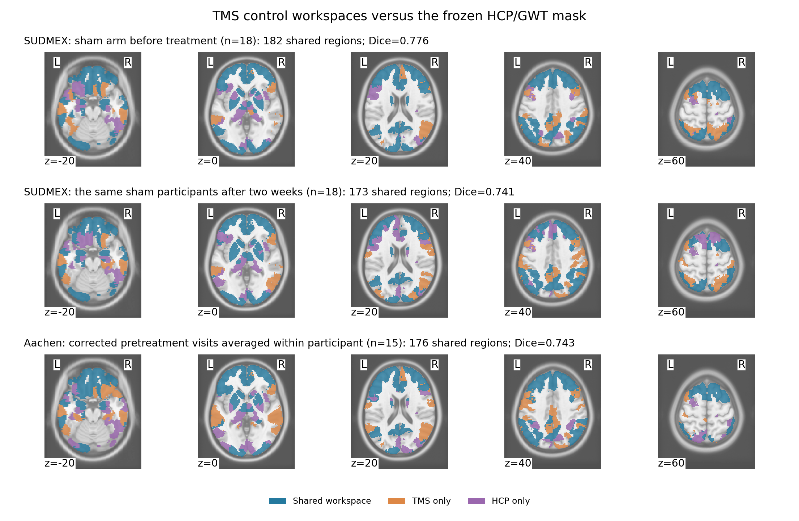
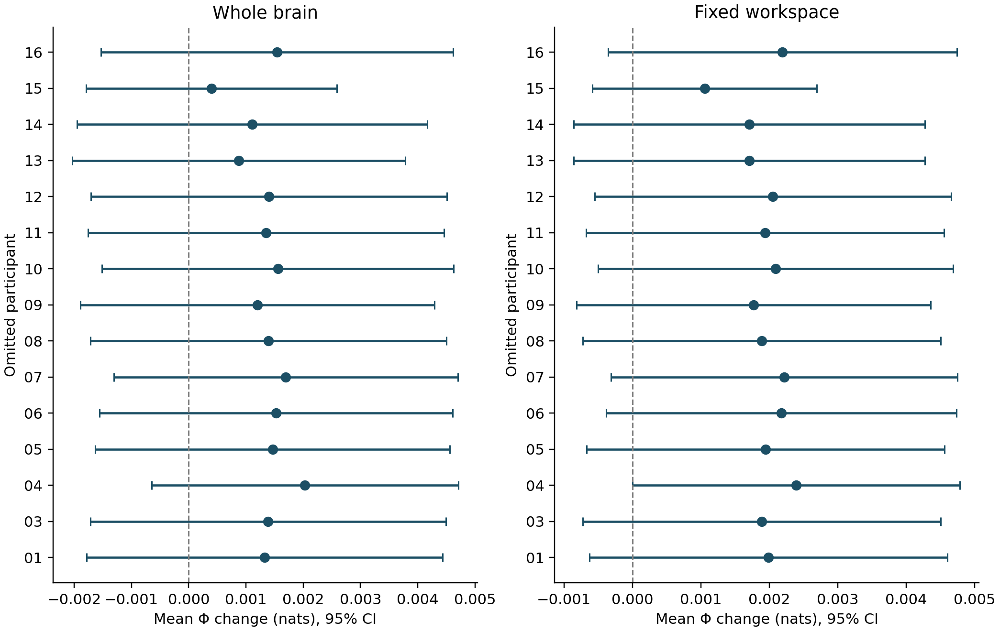
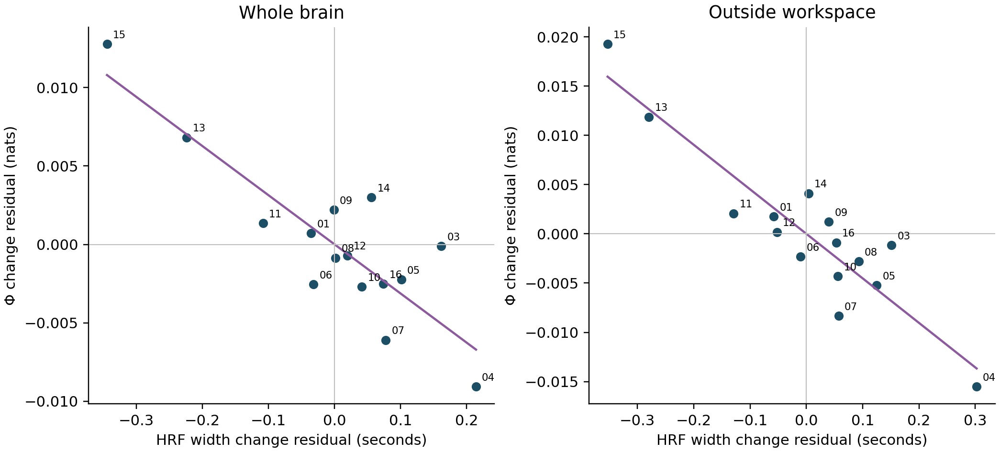

# Supplementary material

Information dynamics following prefrontal theta burst stimulation

## Additional methods

### Acquisition and processing details

We used OpenNeuro dataset ds001832, version 1.0.1 (doi:10.18112/openneuro.ds001832.v1.0.1), originally collected by Alkhasli and colleagues (1). The release contains 16 healthy adults. Each underwent left DLPFC iTBS on two separate visits, at 90% and 120% of resting motor threshold (rMT), in counterbalanced order. Stimulation comprised 600 pulses over 3 minutes 20 seconds, using a figure-of-eight coil and MRI-guided neuronavigation to a target corresponding to Talairach coordinates −45, 45, 35. The protocol consisted of 50-Hz triplets repeated at 5 Hz in intermittent trains (9). Each visit included a 10-minute resting scan before stimulation and another beginning approximately 7 minutes afterward. Participants fixated with eyes open. Stimulation occurred outside the scanner; no pulses were delivered during fMRI acquisition. There was no sham visit.

We excluded one participant because all four runs contained 36 slices but the deposited timing metadata specified 34 slice times, preventing uniform slice-timing correction. The analysed sample comprised 15 participants, 7 women and 8 men, aged 19–44 years (mean 27.87, SD 7.12), with 60 scans. Seven received 90% rMT first and eight received 120% first. All analysed participants contributed both complete pre/post pairs.

### Signal processing

Functional images were acquired at 3 T with TR = 2 seconds, TE = 28 milliseconds, flip angle 77° and voxel dimensions 3 × 3 × 3.75 mm. Most runs contained 300 volumes; two contained 299. We used fMRIPrep 23.2.1 (10) for motion correction, slice-timing correction, anatomical registration and normalization to MNI152NLin2009cAsym at 2-mm resolution. Because the deposited anatomical images were already skull-stripped, fMRIPrep used --skull-strip-t1w skip. Susceptibility-distortion correction and FreeSurfer surface reconstruction were not performed. The first five volumes were removed.

Run-level quality control used translation and rotation thresholds of 3 mm and 3.15°, with a continuous-segment salvage rule requiring at least 8 minutes. All 60 analysed runs were retained. One run flagged relative to the motion-correction reference passed the segment-relative rule without losing additional volumes. Denoising used CONN 25b (11), including five white-matter and five cerebrospinal-fluid aCompCor components (12), six motion parameters and their first derivatives, linear detrending, and regression followed by 0.008–0.09-Hz filtering. Global-signal regression, volume scrubbing and additional spatial smoothing were not applied.

We spatially averaged the cleaned signal within 400 Schaefer cortical parcels (13) and 54 Tian subcortical parcels (14). Regional haemodynamic responses were estimated using the rsHRF implementation of blind deconvolution (5): a 1-SD event threshold, third-order gamma basis, 24-second response window, threefold temporal upsampling, and a 4–8-second onset search. Iterative Wiener deconvolution used 50 iterations. Outputs contained 295 time points for 58 scans and 294 for two scans. Numerical audits confirmed finite outputs, 454 nonconstant regional signals per scan, and deconvolved signals that differed from both their inputs and simple standardized inputs. These checks establish processing integrity, not direct validation of recovered neuronal activity.

### Fixed mask and information aggregation

The fixed HCP workspace contains 235 of 454 regions. For a symmetric pairwise matrix M with undefined diagonal, the within-workspace mean is the mean of Mij over i<j with both i and j in that mask. It contains 27,495 unique pairs. The complement contains 219 regions and 23,871 unique within-complement pairs. The cross-boundary block contains 235×219=51,465 pairs. These three disjoint blocks reconstruct the whole-brain mean when weighted by their pair counts; simply averaging their three means would give the wrong weighting. All 60 Aachen scans had finite estimates on every off-diagonal pair.

Workspace membership was inherited from the independent HCP reference used in the earlier GWT pipeline (4). No HCP participant calculation or psychedelic participant analysis was rerun. TMS processing outputs were read without modification. The scalar within-workspace information mean is an additional analysis, distinct from both the earlier GWT participation/role outcomes and Luppi's edgewise network-based statistics (3).

### Secondary participation and role endpoints

For each node, participation is one minus the sum, across modules, of the squared fractions of its total edge weight assigned to each module. The seven cortical networks and a single subcortical module define eight modules. Self-edges are excluded. PCs use all 454 destinations; restricting destinations to the workspace would alter the original definition. Synergy PCs use persistent synergy and redundancy PCs use persistent redundancy.

The synergy and redundancy PCs are ranked separately among the 235 workspace nodes for each scan. A positive rank difference defines a gateway and a negative difference a broadcaster; ties are neither. The original 20 secondary endpoints comprise two mean workspace PCs, two total role counts, eight network gateway counts and eight network broadcaster counts. These outcomes retain the historical families: two PCs, two total counts, FPN gateways, the seven other network gateway counts, and eight broadcaster counts. The expanded 30- and 40-endpoint sensitivities avoid relying solely on these separate families. No regional role is inferred from the significance of a group-average matrix.

### Conditional null reference

Following the motivation of NuMIT (7), we compared each observed pairwise measure against a model reference at matched joint time-delayed mutual information. This ΦID application is a sensitivity extension; it does not make conditional percentiles additive information atoms (8).

The Aachen coefficient pool used 1,024 randomly selected edges from each of the 30 baseline scans, producing 30,720 bivariate first-order autoregressive coefficient matrices. The sampling seed was 2026112503. The pool was shared across participants and conditions. Random positive-definite innovation covariances and rescaling of stable dynamics generated stationary model covariances at target mutual-information values. Reference generation retained 32,768 valid draws at each 0.005-nat grid point for each of two independent seeds, 2026112511 and 2026112512. Nonfinite draws and draws missing the target information by more than 10⁻⁶ nats were rejected consistently across measures and replenished.

For each empirical value, midrank empirical cumulative probabilities were evaluated in the adjacent reference distributions and linearly interpolated in target mutual information. The two seed estimates were averaged before edge aggregation. The same reference pool and distributions were retained for whole-brain, workspace, outside-workspace and cross-boundary summaries. No scope-specific prior was fitted. Normalized means were multiplied by 100 for reporting as conditional percentiles, and changes as percentile points.

Validation included comparison with the original MATLAB estimates, independent log-determinant calculations, interpolation checks, simulations at finite record lengths and reference-seed comparisons. These establish numerical consistency rather than unbiased estimation or biological validity. Finite-record calibration is retained in Table S9, without claiming that every mean null percentile equals 0.5. Reference-prior uncertainty was not propagated; inference is conditional on the shared baseline-derived reference.

### Sensitivity analyses and correction

All primary changes use the participant as the independent unit. Both visit changes must be available; the analysis does not silently average one visit when the other is missing. The exact maximum-|t| procedure applies each of the 32,768 sign vectors jointly across endpoints and compares observed statistics with the permutation maximum (15). Shared signs preserve dependence between Φ, ΦR and other measures. The reported marginal intervals are not simultaneous intervals.

Holm correction (16) is provided alongside the maximum-t results. Motion models use the uncentered FD change so that the intercept represents zero motion change; centering FD would instead force the intercept to the observed unadjusted mean. HC3 models also examine intensity differences with baseline differences, FD differences and counterbalanced visit order. Results from different spatial scopes and model variants are retained, not chosen according to which crosses a threshold.

Participant-bootstrap intervals used 10,000 resamples. Current whole-brain and workspace checks used seed 2026112526; spatial follow-up checks used seed 2026112528. Leave-one-out analyses remove one person, including both visits, at a time. Signed-rank tests and bootstrap intervals are dependent sensitivities of the same observations and do not provide new confirmatory evidence. All such intervals and unadjusted p values are labelled accordingly in their tables.

### Bounded spatial and signal-representation follow-up

The retained spatial follow-up evaluated two targets: the outside-workspace Φ change and the direct outside-minus-inside change. Visit/intensity consistency used 12 jointly corrected contrasts: two targets each at 90%, 120%, their difference, first visit, second visit and their difference. All use 15 independent participants. Baseline and motion sensitivity comprised six models per raw/normalized branch: two targets with baseline, motion, or both. Baseline values were centered at their sample mean; FD change remained uncentered. Participant influence, signed-rank, sign-test and 10,000-resample bootstrap checks were reported as dependent diagnostics.

The outside-workspace graph was partitioned by the eight fixed network labels. Of 36 possible unordered network-pair blocks, 35 contained edges; the subcortical complement contains only one node, so its within-network block is empty. Joint maximum-t correction covered the 35 estimable blocks. A separate eight-test omission sensitivity removed all edges touching one network at a time. Block means reconstruct the outside-workspace mean only when weighted by their edge counts. A positive result after each omission indicates that no single network is necessary for the aggregate finding; it does not establish significance of any individual network block.

We decomposed mean Φ as mean joint time-delayed mutual information minus mean summed within-region self-information. For each scope, these terms were computed on exactly the same pairs. Nine component tests covered three quantities (joint information, self-information sum, persistent redundancy) at three scopes (within, outside, outside-minus-inside). The group-mean identity is exact, whereas the separate component hypotheses remain subject to correction.

Signal-representation sensitivities used the original deconvolved scans, their first 294 samples, and the denoised BOLD scans before deconvolution. The equal-length check retains each scan's previously estimated HRF; it does not rerun deconvolution on truncated inputs. The same Gaussian covariance-based Φ formula and 2-second lag were used throughout. The 12-test family comprises Φ at four scopes (whole brain, within, outside, their difference) across the three representations. A separate direct method-by-time comparison tests deconvolved-minus-denoised changes in Φ and ΦR at the four scopes, with eight-test correction. No normalized null was applied to the alternative signal representations.

Estimated HRF height, time to peak and full width at half maximum were averaged within and outside the mask; their differences formed a nine-test parameter family. Six motion-adjusted association models related the three HRF-parameter changes to outside-workspace Φ or the outside-minus-inside Φ contrast, with Holm correction. These checks cannot exclude regional or nonlinear haemodynamic contributions. Independent log-determinant calculations agreed with the denoised-BOLD temporal information calculation to within 2.8×10⁻¹⁴ nats.

### Anatomical and signal quality control

All 15 corrected anatomical reconstructions retained 99.63–100% of the supplied native anatomical support; BOLD/T1 mask Dice ranged from 0.881 to 0.956. All 454 regional signals were finite and nonconstant in all 60 retained scans. Some inferior temporal and orbitofrontal parcels nevertheless had low functional brain-mask coverage. Nonzero regional signals and coherent registration do not guarantee full regional signal quality. We retained the predefined cohort and fixed reference rather than selecting participants or parcels according to treatment effects. Regional coverage tables accompany the reproducibility records.

### Recovery of the previously described workspace

We independently derived control workspaces with the same synergy-minus-redundancy strength-rank method used in the earlier pipeline (3, 4). Persistent-synergy and persistent-redundancy matrices were arithmetically averaged, node strengths were ranked separately across all 454 regions, and a positive synergy-minus-redundancy rank identified workspace membership. For Aachen, the two pretreatment matrices were first averaged within participant and then across the same 15 participants. The SUDMEX comparison used the same 18 sham participants at baseline and after the two-week randomized phase (17). Post-stimulation Aachen scans and later open-label SUDMEX visits did not define these control maps.

The maps recovered a broadly similar spatial architecture to the canonical workspace described by Luppi and Yousefi (3, 4) (Figure S1). The SUDMEX sham-baseline map contained 234 regions, sharing 182 with the 235-region HCP reference (Dice=0.776); the two-week map contained 232 regions, sharing 173 (Dice=0.741). The Aachen paired-baseline map contained 239 regions, sharing 176 (Dice=0.743). Corresponding strength-gradient Spearman correlations with HCP were 0.652, 0.615 and 0.596. Aachen FPN overlap was particularly high (43 shared regions; network Dice=0.905), with larger differences in some sensory/attention networks.

This is descriptive spatial correspondence, not proof of identical workspaces or a spatial-null significance test. The copied HCP mask and the HCP mask used in the GWT project are byte-identical and constitute one comparator, not two independent replications. Independently derived TMS maps served quality control only; intervention analyses retained the frozen HCP mask. Aachen baseline-visit maps had Dice=0.782 with one another, and leave-one-person-out maps had Dice=0.960–0.981 with the full baseline map. These checks do not establish a treatment effect or validate every regional signal.

### Literature motivated expectations

Four outcomes form one complete exploratory family: FPN gateways, DAN gateways, mean redundancy participation and mean synergy participation. The directional comparison is an increase, but all tests remain two-sided. The first three changes were reported across the classic-psychedelic conditions in the cited paper; synergy participation increased in three of four conditions (4). Redundancy participation also increased with non-classic drugs, and DAN changes were not exclusive to classic psychedelics. The paper provides no matching directional prediction for global mean Φ or ΦR. We used published findings only, without private psychedelic participant data or maps. Broadcaster changes are complementary role summaries, not independent confirmation of gateway effects.

### Target centred information flow

Corrected individual deposited masks supplied cortical weights for eight Aachen participants and both hemispheres. All sixteen sides met the unchanged cortical-overlap criterion. Five quantities were retained: outgoing-minus-incoming transfer entropy, its unique and synergistic contributions, persistent synergy and persistent redundancy. Weighted target-to-other-region pair summaries excluded self-pairs. The left target and left-minus-right contrast were each tested as a five-measure family; Holm correction across ten tests supplied a wider sensitivity. Exact tests used all 256 participant sign patterns after averaging the two visit changes. Lag-two, equal-length, motion/baseline, intensity and participant-omission checks were retained. Right-sided masks were contralateral comparators, not evidence of right-sided stimulation. Pairwise predictive information does not identify a direct neuronal causal pathway or eliminate common causes.

### Contextual SUDMEX analyses

SUDMEX is a double-blind randomized trial of 5-Hz left-DLPFC rTMS in cocaine use disorder (17). Our acute MRI comparison retained 40 complete pairs, 22 active and 18 sham, at baseline and two weeks. Models compared follow-up outcomes by arm with baseline adjustment and then baseline plus change in mean framewise displacement, using HC3 uncertainty. Sham maps in Figure S1 use the same 18 complete sham pairs. SUDMEX anatomy was audited separately; no Aachen-like repeat-extraction failure was found, although inferior coverage limitations remained.

A longitudinal sensitivity compared baseline with the within-person average of every available post measurement in 41 participants. Later visits included open-label treatment, so this analysis cannot estimate the randomized two-week treatment effect. Its complete forty-endpoint family used 200,000 joint random sign vectors, including the identity pattern. Clinical associations related seven published craving/impulsivity outcomes to eight neural summaries, adjusting for arm, both baseline values and motion change (56-test Holm family). Source-flagged clinical changes were masked; no missing outcome was imputed.

## Supplementary results

### Information and workspace outcomes

No Aachen information family or GWT expectation established a corrected intervention-associated change, before or after conditional normalization. The direct outside-minus-inside Φ difference was −0.000771 nats (95% CI −0.003290 to 0.001747; maximum-t p5=0.935), giving no support to preferential change outside the workspace. All leave-one-participant-out whole-brain Φ estimates remained positive (0.000399–0.002029 nats), but this sign consistency did not establish a reliable group effect (Figure S2). Equal-length whole-brain Φ was +0.001415 nats (95% CI −0.001457 to 0.004287). Complete intensity, motion, influence and reference-seed tables are supplied.

Raw redundancy participation increased by 0.00466 (95% CI 0.00054–0.00879), nominal p=0.0295, but four-expectation Holm p=0.118 and maximum-t p=0.114. Normalized redundancy participation increased by 0.00119, Holm4 p=0.153. Neither establishes the predicted GWT pattern. Raw whole-brain persistent redundancy was essentially unchanged (+0.000047 nats, p=0.954). Normalized DAN gateways decreased nominally (−0.47 regions, p=0.0382), opposite to the expected direction, and failed four-outcome correction (Holm p=0.153).

### Signal representation and estimated haemodynamics

Deconvolution is part of the intended processing (4, 5). Comparison with the denoised representation is a model sensitivity, not a requirement that preprocessing preserve every effect. The direct deconvolved-minus-denoised within-workspace Φ change was +0.002011 nats (eight-test maximum-t p=0.00250). Whole-brain and outside-workspace method interactions did not survive that family. No Φ change in the three-representation, four-scope family survived correction.

None of nine mean HRF-parameter changes survived correction. In the six motion-adjusted association models, however, outside-workspace Φ change was associated negatively with HRF width change (coefficient −0.00755 nats per SD, Holm p=0.000318) and positively with peak-latency change (+0.00713 nats per SD, Holm p=0.0331). These same-signal associations do not establish an independent vascular mechanism or a stimulation effect. They show that estimated temporal-information changes covary with the fitted haemodynamic model.

A bounded follow-up added three whole-brain associations to the six existing models, retaining all nine under Holm correction. Whole-brain HRF parameters were averages across all 454 regions, calculated before within-visit differencing and participant averaging. Whole-brain Φ change was inversely associated with width change (−0.00459 nats per SD, 95% CI −0.00693 to −0.00226; Holm9 p=0.00849). In this expanded family, outside-width and outside-peak p values were 0.000477 and 0.0463. Width slopes remained negative in all fifteen participant omissions; Holm9 support remained in twelve omissions for whole-brain and fourteen for outside-workspace Φ. Unadjusted rank sensitivities gave whole-brain width ρ=−0.695 (Holm9 p=0.0257) and outside width ρ=−0.854 (p=0.000466). The direct spatial-contrast width association did not survive the motion-adjusted nine-test family. These are dependent robustness checks, and the HRF estimates and Φ outputs share the same input signals (Figure S3).

The fresh Aachen conditional reference used 30,720 baseline coefficient matrices, 369 grid points per seed and 32,768 retained draws per point. Maximum interpolation error was 0.000761 CDF units. Simulated finite records showed a maximum mean-percentile departure from 0.5 of 0.0631; normalization is therefore a model sensitivity, not a claim of universally unbiased estimates. The shared fitted prior's uncertainty is not propagated. No historical Aachen reference distribution was reused.

### Target centred and contextual results

No corrected primary target-centred Aachen effect was established in eight participants (minimum within-scope maximum-t p=0.180), and lag-two and equal-length families also had no corrected effect. Three left-minus-right estimates in the baseline-plus-motion HC3 sensitivity survived Holm correction across ten tests: net transfer entropy and its unique and synergistic contributions (each adjusted p=0.0476). These small-sample models have five residual degrees of freedom and maximum leverage up to 0.896. A separate intensity-descriptive family identified decreased left-target persistent synergy at 120% rMT (−0.04120 nats, 95% CI −0.06088 to −0.02152; Holm20 p=0.0331). These model- and intensity-specific findings use the same eight participants and do not establish a robust primary flow effect or causal propagation. The full tables and model diagnostics are retained. The SUDMEX randomized target analysis likewise had no corrected primary result.

SUDMEX's unadjusted acute FPN change contrast was +3.14 gateways (p=0.0486), but the baseline-adjusted estimate was +1.21 (p=0.449) and baseline-plus-motion-adjusted estimate +1.09 (95% CI −2.13 to 4.30; p=0.498). No four-expectation result survived Holm correction in either representation, and no clinical–neural association survived the 56-test family.

The longitudinal SUDMEX sensitivity retained changes that cannot be attributed specifically to randomized treatment: raw whole-brain persistent synergy rose by 0.01815 nats (forty-test maximum-t p=0.00525), while normalized within-workspace source-side synergy fell by 1.664 percentile points (p40=0.0431). Raw whole-brain persistent synergy did not increase after normalization. These results use different time points, estimands and representations from the Aachen acute comparison and do not form a coherent replicated TMS signature.

## Numerical audit

All sixty corrected Aachen scans retained 102,831 finite unique regional pairs. The identity ΦR=Φ+persistent redundancy, symmetry, scan identities and source hashes were checked. Direct covariance calculations reproduced saved MATLAB Φ/ΦR outputs; independent sign-pattern enumeration verified inference. Target-flow numerical identities and weighted summaries agreed with existing production MATLAB outputs. A fresh selected-pair MATLAB validation could not run because the license server was unavailable; this limitation and the retained verification inputs are documented with the target results. The control-workspace maps, overlap statistics and reference hashes passed a separate independent review. Production processing code and frozen HCP/psychedelic computations were unchanged.

## Supplementary tables and participant outputs

- Table S1: Main information and role outcomes (raw_aachen_main30.csv; normalized_aachen_main30.csv; raw_aachen_all40.csv; normalized_aachen_all40.csv)
- Table S2: Four GWT expectations (gwt_expectations_raw.csv; gwt_expectations_normalized.csv)
- Table S3: Spatial information and direct interaction (raw_aachen_information20.csv; normalized_aachen_information20.csv; aachen_spatial_interactions.csv)
- Table S4: Motion and intensity (aachen_all_spatial_motion.csv; aachen_intensity_results.csv; aachen_robustness.csv)
- Table S5: Influence and reference seeds (aachen_leave_one_out.csv; normalization_seed_tests.csv)
- Table S6: SUDMEX acute and longitudinal (raw_sudmex_acute.csv; normalized_sudmex_acute.csv; sudmex_all_post_all40_results.csv; sudmex_all_post_arm_results.csv)
- Table S7: Clinical associations (clinical_neural_associations.csv)
- Table S8: Signal representations networks visits and haemodynamics (sensitivities/*.csv)
- Table S9: Null calibration and reference stability (normalization/*.csv)
- Table S10: Corrected Aachen target centred flow (target_flow/*.csv)
- Table S11: Whole brain haemodynamic association and influence follow-up (haemodynamic_followup/*.csv)

Raw information estimates are in nats; normalized information CSV estimates use CDF units, so multiplication by 100 gives percentile points. Participation coefficients and region counts retain their own units. P values are two-sided; confidence intervals are marginal. Each table identifies its family. Missing values indicate unestimable models or untested diagnostics and must not be read as zero. Full test inventories are retained, including nonsignificant outcomes.

## Supplementary figures

Figure S1. Recovery of the reference workspace in TMS control scans. Rows show SUDMEX sham participants before treatment and after the two-week randomized phase (the same 18 people), and Aachen pretreatment visits averaged within participant (15 people). Blue indicates regions shared with the fixed HCP workspace, orange regions present only in the TMS-derived workspace and purple regions present only in HCP. Axial coordinates are in millimetres. The figure documents broad spatial correspondence with prior workspace work (3, 4), with incomplete overlap. The maps do not replace the independent HCP mask used in intervention analyses.

Figure S2. Leave-one-participant-out raw Φ changes. Each point uses the remaining fourteen participants' mean visit changes; bars are marginal 95% Student-t intervals. Labels identify the omitted participant. These dependent influence checks are not independent replications.

Figure S3. Association between estimated HRF width and Φ changes. Points represent fifteen participants; labels show dataset identifiers. The two visit changes are averaged within participant. Axes show residuals after linear adjustment for change in mean framewise displacement, and lines show the corresponding partial slopes. Inferential coefficients in Table S11 use standardized HRF changes and HC3 uncertainty. Fitted HRF parameters and information estimates originate from the same signals, so the association does not distinguish physiological effects from mathematical coupling introduced by deconvolution.

## References

References use the numbering of the main manuscript.

1. Alkhasli I, Sakreida K, Mottaghy FM, Binkofski F. Modulation of Fronto-Striatal Functional Connectivity Using Transcranial Magnetic Stimulation. Frontiers in Human Neuroscience. 2019;13:190. doi:10.3389/fnhum.2019.00190.

9. Huang YZ, Edwards MJ, Rounis E, Bhatia KP, Rothwell JC. Theta Burst Stimulation of the Human Motor Cortex. Neuron. 2005;45:201-206. doi:10.1016/j.neuron.2004.12.033.

10. Esteban O, Markiewicz CJ, Blair RW, Moodie CA, Isik AI, Erramuzpe A, et al. fMRIPrep: a robust preprocessing pipeline for functional MRI. Nature Methods. 2019;16:111-116. doi:10.1038/s41592-018-0235-4.

11. Whitfield-Gabrieli S, Nieto-Castanon A. Conn: A Functional Connectivity Toolbox for Correlated and Anticorrelated Brain Networks. Brain Connectivity. 2012;2:125-141. doi:10.1089/brain.2012.0073.

12. Behzadi Y, Restom K, Liau J, Liu TT. A component based noise correction method (CompCor) for BOLD and perfusion based fMRI. NeuroImage. 2007;37:90-101. doi:10.1016/j.neuroimage.2007.04.042.

13. Schaefer A, Kong R, Gordon EM, Laumann TO, Zuo XN, Holmes AJ, et al. Local-Global Parcellation of the Human Cerebral Cortex from Intrinsic Functional Connectivity MRI. Cerebral Cortex. 2018;28:3095-3114. doi:10.1093/cercor/bhx179.

14. Tian Y, Margulies DS, Breakspear M, Zalesky A. Topographic organization of the human subcortex unveiled with functional connectivity gradients. Nature Neuroscience. 2020;23:1421-1432. doi:10.1038/s41593-020-00711-6.

5. Wu GR, Liao W, Stramaglia S, Ding JR, Chen H, Marinazzo D. A blind deconvolution approach to recover effective connectivity brain networks from resting state fMRI data. Medical Image Analysis. 2013;17:365-374. doi:10.1016/j.media.2013.01.003.

4. Yousefi P, Shinozuka K, Vizeli P, Holze F, Becker AM, Muller F, et al. Psychedelics Restructure the Global Workspace of Consciousness. bioRxiv [Preprint]. 2026:version 1. doi:10.64898/2026.09.28.755172v1.

3. Luppi AI, Mediano PA, Rosas FE, Allanson J, Pickard J, Carhart-Harris RL, et al. A synergistic workspace for human consciousness revealed by Integrated Information Decomposition. eLife. 2024;12:RP88173. doi:10.7554/elife.88173.

7. Liardi A, Rosas FE, Carhart-Harris RL, Blackburne G, Bor D, Mediano PAM. Null models for comparing information decomposition across complex systems. PLOS Computational Biology. 2025;21:e1013629. doi:10.1371/journal.pcbi.1013629.

8. Blackburne G, Liardi A, Mallaroni P, McAlpine R, Carhart-Harris R, Timmermann C, et al. Psychedelics restructure information in the human brain. bioRxiv [Preprint]. 2026:version 2. doi:10.64898/2026.10.01.755915v2.

15. Winkler AM, Ridgway GR, Webster MA, Smith SM, Nichols TE. Permutation inference for the general linear model. NeuroImage. 2014;92:381-397. doi:10.1016/j.neuroimage.2014.01.060.

16. Holm S. A simple sequentially rejective multiple test procedure. Scandinavian Journal of Statistics. 1979;6:65–70.

17. Garza-Villarreal EA, Alcala-Lozano R, Fernandez-Lozano S, Morelos-Santana E, Dávalos A, Villicaña V, et al. Clinical and Functional Connectivity Outcomes of 5-Hz Repetitive Transcranial Magnetic Stimulation as an Add-on Treatment in Cocaine Use Disorder: A Double-Blind Randomized Controlled Trial. Biological Psychiatry: Cognitive Neuroscience and Neuroimaging. 2021;6:745–757. doi:10.1016/j.bpsc.2021.01.003.
