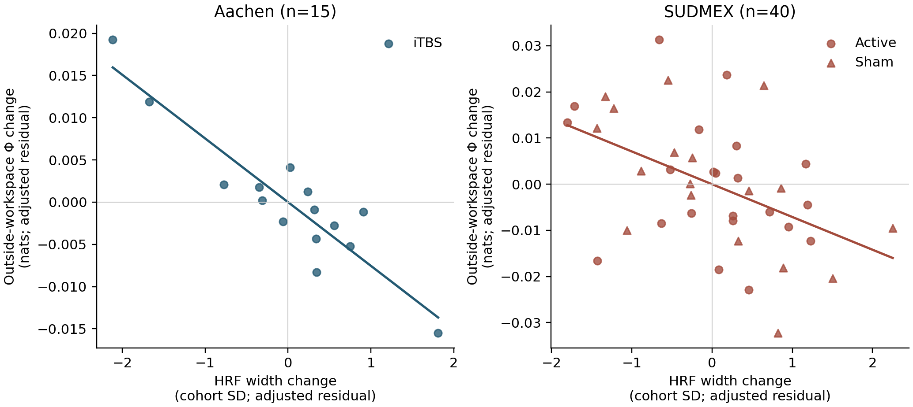
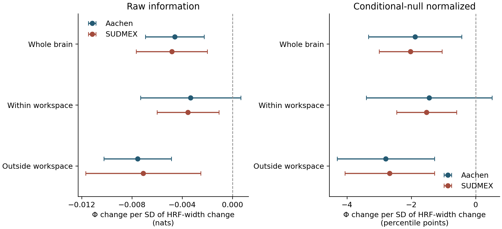

# Haemodynamic covariation of information integration across two prefrontal stimulation datasets

Article type: Brief Research Report

Keywords: transcranial magnetic stimulation; resting state fMRI; integrated information decomposition; haemodynamic response; global workspace

## Abstract

Information decomposition characterizes brain dynamics from fMRI signals whose temporal structure depends on haemodynamics. We examined whether changes in pairwise information integration differed inside and outside an independent workspace, and whether these changes covaried with the estimated haemodynamic response. Two datasets provided 15 healthy participants undergoing acute intermittent theta burst stimulation and 40 participants with cocaine use disorder in a two-week active-versus-sham trial. Both were analysed with the same parcellation, deconvolution and information estimator. No workspace-versus-outside treatment contrast survived correction across five information measures. Narrower estimated haemodynamic responses accompanied greater whole-brain Φ changes in both datasets. The outside-workspace association survived correction across fifteen haemodynamic associations in both raw and conditional-null-normalized analyses; cross-dataset conjunction p values were 0.046 and 0.025. Baseline adjustment retained the raw association, but some normalized and participant-omission checks lost corrected support. Neither replicated spatial selectivity nor stimulation specificity was established. These exploratory findings identify haemodynamic covariation in information-integration estimates across two datasets, while leaving its physiological and algorithmic contributions unresolved.

## Introduction

Transcranial magnetic stimulation can affect brain networks beyond its cortical target (1, 2). Information decomposition offers a way to describe such distributed dynamics, distinguishing information shared by regions from information available only when they are considered jointly (3). Previous work identified a synergistic workspace (4) and changes in its network participation during psychedelic conditions (5). Whether prefrontal stimulation preferentially changes information processing within or beyond this workspace remains uncertain.

This question also depends on measurement. fMRI reflects haemodynamic responses, and blind deconvolution estimates regional response functions before inferring latent signals (6). Information measures applied to those signals may therefore covary with fitted haemodynamic parameters. We examined spatial contrasts and this covariation in two prefrontal-stimulation datasets, retaining separate estimates for their different populations and treatment designs.

## Methods

### Datasets and common processing

Aachen provided resting-state fMRI from 15 healthy adults before and after two left-dorsolateral-prefrontal iTBS visits, at 90% and 120% of resting motor threshold (OpenNeuro ds001832, version 1.0.1) (1). Each visit used 600 pulses. One deposited participant was excluded because slice-timing metadata did not match the acquired slices. The 60 retained scans supplied two complete within-visit changes per participant, which were averaged. There was no sham condition.

SUDMEX contributed 40 participants with complete baseline and two-week scans from a randomized trial of 5-Hz left-prefrontal rTMS for cocaine use disorder: 22 assigned active stimulation and 18 sham (OpenNeuro ds003037, version 1.0.1) (2). Later open-label visits were excluded from the present treatment comparison. The datasets were not pooled.

Both datasets used the established GWT processing framework (5): fMRIPrep registration, CONN denoising, 454 Schaefer/Tian regional signals and rsHRF blind deconvolution (6). Aachen's already stripped anatomical images were processed without a second brain extraction; corrected alignment and downstream outputs were validated. Gaussian minimum-mutual-information ΦID used a two-second lag. Supplementary Methods detail processing and remaining coverage limitations.

### Spatial information and haemodynamic summaries

Φ was joint past–future mutual information minus the sum of each region's own past–future mutual information (7). It is a pairwise whole-minus-sum measure, can be negative, and is not synergy alone. We averaged it across 102,831 unique whole-brain pairs, 27,495 pairs within the frozen 235-region HCP workspace and 23,871 pairs entirely outside it. The workspace was inherited from the previous pipeline (5) and was not selected from treatment results. Redundancy-corrected ΦR, persistent synergy, persistent redundancy and source synergy completed a five-measure spatial family.

Estimated HRF height, peak latency and full width at half maximum were averaged over the corresponding regions. Within-visit changes were calculated before averaging Aachen's two visits. SUDMEX used the baseline-to-two-week change. A previously computed conditional-null sensitivity placed each information measure relative to a model distribution matched on joint time-delayed mutual information (8, 9). These normalized values are conditional percentiles, not additive information atoms.

### Statistical analysis

The direct spatial contrast was the outside-minus-inside difference in information change. Aachen used paired tests with all 32,768 joint sign patterns; SUDMEX estimated the active-minus-sham difference in follow-up spatial contrasts, adjusting for their baseline values and motion change. The five information measures received family-wise correction in each dataset and representation. Separate significant and nonsignificant compartment results were not treated as evidence of a spatial difference.

Exploratory haemodynamic models related Φ change to standardized HRF-parameter change, adjusting for mean framewise-displacement change and, in SUDMEX, treatment arm. HC3 uncertainty and two-sided t tests were used. One complete fifteen-test family comprised three HRF parameters at four scopes (whole brain, inside, outside and their direct difference), plus three tests relating the direct Φ difference to a common whole-brain HRF predictor. Holm correction covered all fifteen associations (10). A same-direction conjunction used the larger of the two cohort p values, followed by Holm correction across the fifteen matching endpoints; it did not pool treatment effects. These analyses extend earlier exploratory Aachen results.

Sensitivity models added baseline Φ and HRF values, examined treatment-arm interactions and arm-specific slopes in SUDMEX, repeated raw models after each participant omission, and used rank correlations. Raw and normalized analyses and all nonsignificant outcomes were retained. Confidence intervals are marginal 95% intervals.

## Results

### Spatial contrasts did not establish a preferential treatment response

Control workspaces showed broad correspondence with the reference literature (4, 5): Dice overlap was 0.743 in Aachen and 0.776/0.741 in matched SUDMEX sham scans (Supplementary Figure S1). This was descriptive spatial correspondence, not proof of identical masks.

No direct outside-versus-inside treatment contrast survived its five-measure family in either dataset, before or after normalization (Table 2). For raw Φ, Aachen's difference in change was −0.000771 nats (95% CI −0.003290 to 0.001747; maximum-t p=0.935). SUDMEX's baseline-and-motion-adjusted active-minus-sham contrast was −0.000472 nats (−0.007191 to 0.006247; Holm p=1.000). These intervals do not establish equivalence.

### Haemodynamic width covaried with Φ in both datasets

Outside the workspace, each one-SD increase in fitted HRF-width change was associated with a Φ-change difference of −0.007548 nats in Aachen (95% CI −0.010242 to −0.004854; Holm15 p=0.000795) and −0.007102 nats in SUDMEX (−0.011673 to −0.002531; p=0.0392). Thus narrowing accompanied larger Φ changes (Figure 1). Whole-brain width associations also survived within-dataset correction (p=0.0149 and 0.0213). Same-direction cross-dataset conjunction p values were 0.0213 for whole brain and 0.0458 outside the workspace.

The outside-workspace association remained in the normalized analysis: slopes were −2.795 and −2.676 percentile points per SD in Aachen and SUDMEX, respectively (Holm15 p=0.0253 and 0.0057; conjunction p=0.0253; Figure 2). Whole-brain normalized associations did not survive correction in both datasets. Within-workspace associations were not supported in both datasets, and direct spatial tests did not establish that the width relationship was consistently stronger outside the workspace.

Baseline adjustment retained the raw outside-workspace association in both cohorts (Holm15 p=0.0271 and 0.0309), but the normalized Aachen association lost corrected support. Raw width slopes remained negative in every participant omission; corrected outside-workspace support persisted in 14/15 Aachen and 26/40 SUDMEX omissions. In SUDMEX, active and sham slopes were both negative, but neither arm-specific raw association survived its full family. The arm-by-width interaction was not supported (uncorrected p=0.338; Holm15 p=1.000). This does not prove equal slopes or a treatment-independent mechanism.

## Discussion

The shared finding across these datasets was covariation between fitted haemodynamic response width and estimated information integration. Narrower responses accompanied larger whole-brain Φ changes, and the outside-workspace association was also present after conditional-null normalization. This provides a common measurement-focused result across healthy participants undergoing acute iTBS and a clinical active-versus-sham rTMS trial.

The spatial findings require a narrower interpretation than preferential modulation outside a global workspace. Neither dataset established a direct outside-versus-inside treatment contrast, and the haemodynamic slope difference did not generalize across cohorts. A supported outside-workspace association alongside weaker within-workspace evidence does not itself demonstrate spatial selectivity. The fixed independent mask and full contrast inventory make this distinction explicit.

The biological interpretation remains unresolved. HRF parameters and deconvolved signals are estimated from the same BOLD data. Their association can therefore reflect physiological variation, properties of the estimator or both; it is not independent vascular validation or mediation of a stimulation effect. SUDMEX did not establish treatment specificity, and Aachen lacked sham. The cohorts differ in diagnosis, stimulation protocol and interval, supporting cross-dataset comparison of associations rather than a pooled treatment estimate. Small samples, regional signal coverage, exploratory analysis selection and sensitivity to some baseline and omission checks further limit certainty.

For this pipeline, apparent changes in Φ should be interpreted together with their estimated haemodynamic context. The results support a reproducible association across two datasets, while independent physiological measurements and controlled replication are needed to establish its source.

## Data availability

The source imaging is publicly available in OpenNeuro ds001832, version 1.0.1 (doi:10.18112/openneuro.ds001832.v1.0.1), and ds003037, version 1.0.1 (doi:10.18112/openneuro.ds003037.v1.0.1). Analysis code, complete result families, the dashboard and manuscript are available at https://github.com/Parssayousefi/TMS_GWT. No private psychedelic participant data or effect maps were used.

## Ethics statement

This secondary analysis used publicly released, deidentified data and involved no new recruitment or participant contact. Original acquisition approvals and consent procedures are described in the source studies (1, 2).

## Acknowledgments

We thank the original investigators for making these datasets available and the developers of the analysis tools.

## Generative AI statement

OpenAI Codex assisted with code preparation and manuscript drafting. Numerical claims were checked against saved outputs and independent matrix calculations. Responsibility for the final content remains with the investigators.

## Figures and tables

Figure 1. Outside-workspace Φ changes and estimated HRF-width changes in both datasets. Points represent independent participants. Both axes are residualized for motion change and, in SUDMEX, treatment arm; HRF-width changes are standardized within cohort before residualization. Lines show the corresponding adjusted slopes. Shapes distinguish SUDMEX treatment arms. The models do not identify vascular causality.

Figure 2. HRF-width associations across spatial scopes. Points and marginal 95% intervals show separately fitted Aachen and SUDMEX slopes. Raw estimates are nats per cohort SD of width change; normalized estimates are percentile points per SD. Spatial differences require direct tests, not comparison of individual p values.

Table 1. HRF-width associations in both cohorts.

| Dataset | Scale | Scope | Estimate [95% CI] | Holm15 p |
| --- | --- | --- | --- | --- |
| Aachen | raw | Whole brain | -0.00459 [-0.00693, -0.00226] | 0.01485 |
| Aachen | raw | Within | -0.00333 [-0.00731, 0.00066] | 0.49514 |
| Aachen | raw | Outside | -0.00755 [-0.01024, -0.00485] | 0.00079 |
| SUDMEX | raw | Whole brain | -0.00482 [-0.00765, -0.00199] | 0.02131 |
| SUDMEX | raw | Within | -0.00354 [-0.00601, -0.00108] | 0.06710 |
| SUDMEX | raw | Outside | -0.00710 [-0.01167, -0.00253] | 0.03923 |
| Aachen | normalized | Outside | -2.79515 [-4.30823, -1.28207] | 0.02526 |
| SUDMEX | normalized | Outside | -2.67565 [-4.06794, -1.28335] | 0.00569 |

Raw estimates are nats per SD; normalized estimates are percentile points per SD. Holm correction covers the complete fifteen-association family in each dataset and representation. All height, latency, direct spatial and sensitivity results are supplied in Supplementary Data.

Table 2. Direct outside-minus-inside treatment contrasts.

| Dataset | Measure | Estimate [95% CI] | Adjusted p |
| --- | --- | --- | --- |
| Aachen | Persistent synergy | -0.00579 [-0.01552, 0.00394] | 0.6218 |
| SUDMEX | Persistent synergy | -0.00374 [-0.03093, 0.02345] | 1.0000 |
| Aachen | Persistent redundancy | -0.00103 [-0.00375, 0.00168] | 0.8754 |
| SUDMEX | Persistent redundancy | -0.00237 [-0.00900, 0.00426] | 1.0000 |
| Aachen | Source synergy | -0.00471 [-0.00889, -0.00053] | 0.1203 |
| SUDMEX | Source synergy | -0.00258 [-0.01412, 0.00896] | 1.0000 |
| Aachen | Φ | -0.00077 [-0.00329, 0.00175] | 0.9349 |
| SUDMEX | Φ | -0.00047 [-0.00719, 0.00625] | 1.0000 |
| Aachen | ΦR | -0.00180 [-0.00409, 0.00048] | 0.3760 |
| SUDMEX | ΦR | -0.00316 [-0.01119, 0.00487] | 1.0000 |

Aachen estimates average its two within-visit changes. SUDMEX estimates active-minus-sham differences adjusted for baseline spatial contrast and motion change. They are different treatment estimands and are not pooled. All raw estimates are nats; intervals are marginal 95% intervals. The reported correction is exact maximum-t5 for Aachen and Holm5 for SUDMEX.

## References

1. Alkhasli I, Sakreida K, Mottaghy FM, Binkofski F. Modulation of Fronto-Striatal Functional Connectivity Using Transcranial Magnetic Stimulation. Frontiers in Human Neuroscience. 2019;13:190. doi:10.3389/fnhum.2019.00190.

2. Garza-Villarreal EA, Alcala-Lozano R, Fernandez-Lozano S, Morelos-Santana E, Dávalos A, Villicaña V, et al. Clinical and Functional Connectivity Outcomes of 5-Hz Repetitive Transcranial Magnetic Stimulation as an Add-on Treatment in Cocaine Use Disorder: A Double-Blind Randomized Controlled Trial. Biological Psychiatry: Cognitive Neuroscience and Neuroimaging. 2021;6:745–757. doi:10.1016/j.bpsc.2021.01.003.

3. Mediano PAM, Rosas FE, Luppi AI, Carhart-Harris RL, Bor D, Seth AK, et al. Toward a unified taxonomy of information dynamics via Integrated Information Decomposition. Proceedings of the National Academy of Sciences. 2025;122:e2423297122. doi:10.1073/pnas.2423297122.

4. Luppi AI, Mediano PA, Rosas FE, Allanson J, Pickard J, Carhart-Harris RL, et al. A synergistic workspace for human consciousness revealed by Integrated Information Decomposition. eLife. 2024;12:RP88173. doi:10.7554/elife.88173.

5. Yousefi P, Shinozuka K, Vizeli P, Holze F, Becker AM, Muller F, et al. Psychedelics Restructure the Global Workspace of Consciousness. bioRxiv [Preprint]. 2026:version 1. doi:10.64898/2026.09.28.755172v1.

6. Wu GR, Liao W, Stramaglia S, Ding JR, Chen H, Marinazzo D. A blind deconvolution approach to recover effective connectivity brain networks from resting state fMRI data. Medical Image Analysis. 2013;17:365-374. doi:10.1016/j.media.2013.01.003.

7. Barrett AB, Seth AK. Practical Measures of Integrated Information for Time-Series Data. PLoS Computational Biology. 2011;7:e1001052. doi:10.1371/journal.pcbi.1001052.

8. Liardi A, Rosas FE, Carhart-Harris RL, Blackburne G, Bor D, Mediano PAM. Null models for comparing information decomposition across complex systems. PLOS Computational Biology. 2025;21:e1013629. doi:10.1371/journal.pcbi.1013629.

9. Blackburne G, Liardi A, Mallaroni P, McAlpine R, Carhart-Harris R, Timmermann C, et al. Psychedelics restructure information in the human brain. bioRxiv [Preprint]. 2026:version 2. doi:10.64898/2026.10.01.755915v2.

10. Holm S. A simple sequentially rejective multiple test procedure. Scandinavian Journal of Statistics. 1979;6:65–70.
